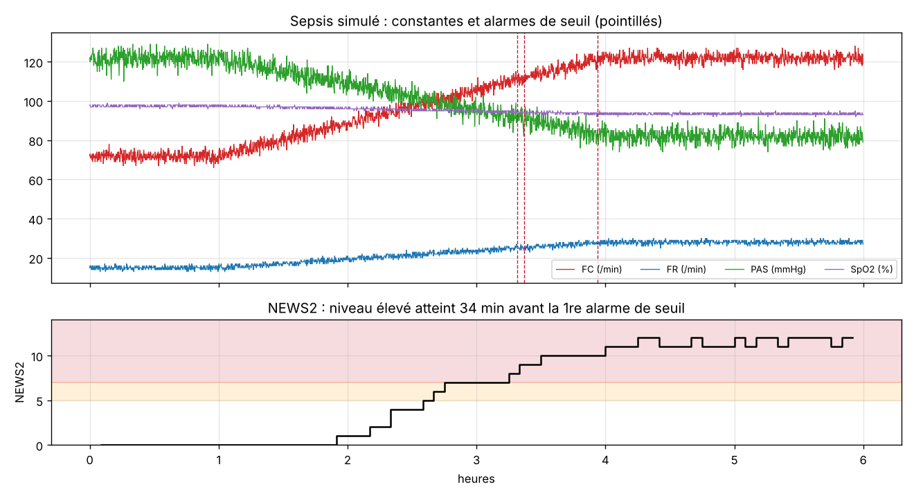

# VitalWatch IoT : simulateur de monitoring patient et système d'alerte

🇫🇷 [Français](#français) · 🇬🇧 [English](#english)

**Essayer la démo / Try the demo :** https://valentin-auger-laboratoire.github.io/portfolio/demos/vitalwatch/



> Patient, capteur et réseau **simulés**. Projet d'étude, **pas un dispositif médical**.

---

## Français

### Le problème
Un capteur connecté au lit du patient envoie ses constantes au poste de soins. Deux difficultés :
- le **réseau n'est pas parfait** : des messages se perdent, arrivent en retard ou dans le désordre, la liaison peut couper ;
- les **alarmes** doivent être fiables. Trop d'alarmes pour rien, et l'équipe finit par ne plus les écouter. Pas assez, et on rate une dégradation.

### Ce que fait le code
- **Patient virtuel** : FC, FR, SpO2, pression systolique et température, avec cinq scénarios (stable, sepsis progressif, désaturation, oxymètre qui glisse du doigt, réseau dégradé).
- **Capteur IoT** : une mesure toutes les 10 s, envoyée en JSON avec un numéro de séquence, comme sur un bus MQTT.
- **Réseau** : pertes, latence variable, désordre, coupures.
- **Moniteur central** :
  - remet les messages dans l'ordre et compte les pertes ;
  - signale une **liaison perdue** après 60 s sans mesure ;
  - déclenche les **alarmes de seuil** avec **persistance** (30 s) et **hystérésis**, pour ne pas sonner sur un pic isolé ni clignoter autour du seuil ;
  - reconnaît un **artefact d'oxymètre** (SpO2 effondrée avec FC aberrante) et lance une alarme **technique** « vérifier le capteur » plutôt qu'une alarme clinique ;
  - calcule le **NEWS2** toutes les 5 minutes, sur les médianes des 5 dernières minutes, et signale chaque hausse du niveau de réponse.

### Utilisation
```bash
python simulateur.py            # les 5 scénarios
python simulateur.py sepsis
```
```
== Scénario sepsis : 2160 mesures émises, 2114 reçues, 46 déclarées perdues
   2 h 35  [NEWS2] score 5 : niveau de réponse moyen
   2 h 45  [NEWS2] score 7 : niveau de réponse élevé
   3 h 19  [clinique] ALARME fr trop haute (26)
   3 h 22  [clinique] ALARME pas trop basse (89)
```
Le NEWS2, qui combine plusieurs constantes légèrement anormales, atteint le niveau élevé **34 minutes avant** la première alarme de seuil.

### Fichiers
| Fichier | Contenu |
|---|---|
| `demo/` | démo web (copie de celle du portfolio), avec ses tests : `node demo/tests/test.js` |
| `vitalwatch/news2.py` | barème NEWS2 (échelle 1 de SpO2) et niveaux de réponse |
| `vitalwatch/simulation.py` | patient virtuel, capteur, réseau imparfait |
| `vitalwatch/moniteur.py` | remise en ordre, alarmes cliniques et techniques, NEWS2 |
| `simulateur.py` | journal des alertes pour chaque scénario |
| `figures.py` | figure ci-dessus (matplotlib) |
| `tests/test_vitalwatch.py` | 43 vérifications : `python tests/test_vitalwatch.py` |

Les tests vérifient notamment chaque borne du barème NEWS2, qu'un pic de 20 s ne déclenche rien, qu'une valeur qui oscille autour du seuil ne donne qu'une seule alarme, qu'un artefact ne déclenche jamais d'alarme clinique, que des messages livrés dans le désordre donnent exactement le même journal, et qu'un patient stable ne génère aucune alerte.

### Limites
- Constantes simulées par des tendances simples, sans vrai modèle physiologique.
- Pas de vrai broker MQTT ni de chiffrement : le transport est simulé dans le programme.
- Seuils d'alarme indicatifs : en pratique, ils se règlent patient par patient.

Dépendance : `numpy` (et `matplotlib` pour la figure). Projet écrit en 2026.

---

## English

**IoT patient-monitoring simulator with an alert system.** A virtual patient and a bedside sensor publish vital signs every 10 s as JSON messages; a lossy network drops, delays and reorders them. The central monitor reorders by sequence number, counts losses, raises a "link lost" alarm, triggers threshold alarms with **persistence and hysteresis**, recognises **oximeter artefacts** as technical alarms, and computes **NEWS2** every 5 minutes. In the sepsis scenario, NEWS2 reaches the high level 34 minutes before the first threshold alarm.

```bash
python simulateur.py
python tests/test_vitalwatch.py   # 43 checks
```

Everything is **simulated**. Study project, not a medical device. Requires `numpy` (`matplotlib` for the figure). Written in 2026.
